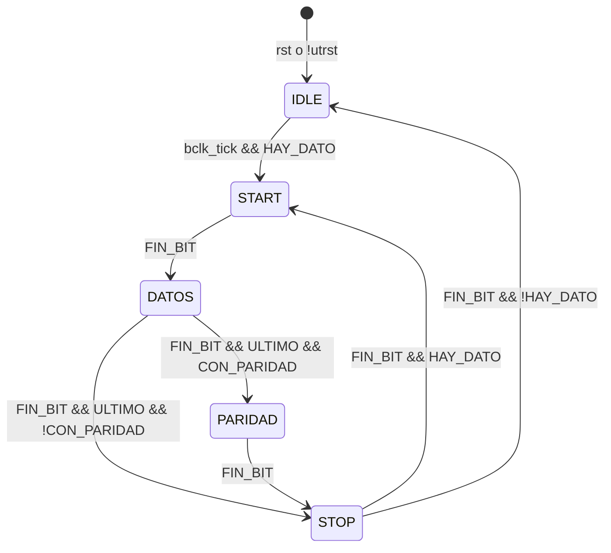

# Transmisor del UART: *Transmitter Timing and Control*

Bloque de la UART que convierte una letra que llega **en paralelo** (8 bits a la vez) en una trama **en serie** que sale por un solo cable (`txd`), con el formato que indique el registro de línea (LCR).

## 1. Descripción

| Archivo | Función |
|---|---|
| `uart_tx_ctrl.sv` | Versión principal en SystemVerilog |
| `uart_tx_ctrl.v` | La misma lógica en Verilog clásico (es la que se usa en `../Formal/`) |
| `uart_tx_simple.sv` | Versión corta y compacta |

### Ciclo de transmisión

Toma el carácter que está esperando en el TX FIFO, lo guarda en un registro de desplazamiento (TSR) y lo envía bit por bit, cada uno durante 16 pulsos del metrónomo `bclk_tick` (13 si `osm_sel = 1`):

```
reposo   start   D0  D1  D2  D3  D4  D5  D6  D7   paridad   stop   reposo
  1        0     ←  datos, bit menos significativo primero  →  (opcional)  1       1
```

En resumen:

1. Si hay una letra en la fila y el metrónomo marca un tick, la toma (`tx_pop`) y empieza a transmitir.
2. Baja el cable a 0 un bit (**start**) para avisarle al receptor.
3. Envía los 5 a 8 bits de datos, empezando por el menos significativo (LSB primero).
4. Si la paridad está activada, envía un bit de paridad.
5. Sube el cable a 1 durante 1, 1.5 o 2 bits (**stop**).
6. Si ya hay otra letra esperando, empieza la siguiente sin pausa; si no, vuelve a reposo.

### Entradas (16)

| Señal | Ancho | Viene de | Para qué sirve |
|---|---|---|---|
| `clk` | 1 | Sistema | Reloj |
| `rst` | 1 | Sistema | Reset general, síncrono, activo en 1 |
| `bclk_tick` | 1 | Generador de baudios | Metrónomo: 16 (o 13) pulsos por bit |
| `osm_sel` | 1 | Control | `0` = 16 ticks por bit, `1` = 13 ticks por bit |
| `tx_data` | 8 | TX FIFO | La letra que se va a enviar |
| `tx_empty` | 1 | TX FIFO | `1` = la fila está vacía |
| `wls` | 2 | LCR | Bits por letra: `00`=5, `01`=6, `10`=7, `11`=8 |
| `pen` | 1 | LCR | `1` = con paridad |
| `eps` | 1 | LCR | `1` = paridad par, `0` = impar |
| `sp` | 1 | LCR | `1` = paridad fija (stick parity) |
| `stb` | 1 | LCR | `0` = 1 stop, `1` = 1.5 stop (con 5 bits) o 2 stop |
| `bc` | 1 | LCR | Break: fuerza la línea a 0 |
| `utrst` | 1 | PWREMU_MGMT | `1` = transmisor encendido, `0` = reset del transmisor |
| `cts_n` | 1 | Pin externo | `0` = puede enviar, `1` = esperar |
| `afe` | 1 | MCR | `1` = obedecer `cts_n` (auto-flow control) |
| `loop` | 1 | MCR | `1` = modo loopback |

### Salidas (5)

| Señal | Va hacia | Qué indica |
|---|---|---|
| `txd` | Pin TX | La línea serie: aquí sale la letra |
| `tx_pop` | TX FIFO | "Ya tomé la letra": pide la siguiente (un pulso de un ciclo, es la señal interna `CARGA`) |
| `tsr_empty` | LSR (TEMT) | `1` = no hay ninguna letra enviándose |
| `tx_serial_loop` | Receptor | Copia de la línea para el modo loopback |
| `tx_busy` | Emulación | `1` = está enviando (es la señal interna `OCUPADO`) |

---

## 2. Por dentro: las cuatro piezas

| Pieza | Señal en el código | Qué hace |
|---|---|---|
| **(a) TSR** | `TSR[7:0]` | Registro de desplazamiento. Guarda la letra; el bit `TSR[0]` es el que sale. Se carga con `CARGA` y se corre a la derecha con `DESPLAZA`, metiendo un 1 por la izquierda |
| **(b) Contador de ticks** | `CUENTA_TICK` | Cuenta los `bclk_tick` dentro de cada bit. Cuando llega al final (`FIN_BIT_N`, o `FIN_STOP_N` en STOP) avisa `FIN_BIT` y vuelve a 0 |
| **(c) Contador de bits** | `CUENTA_BIT` | Dice qué bit de datos está saliendo (D0…D7). Se compara con `ULTIMO_BIT` para generar `ULTIMO` |
| **(d) FSM** | `presente` / `futuro` | Máquina de estados de 5 estados. Decide en qué parte de la trama vamos y genera `SEL` y `OCUPADO`; con el estado presente y `FIN_BIT` se calculan las órdenes `CARGA` y `DESPLAZA` |

Piezas de apoyo:

- **Foto de configuración** (`ULTIMO_BIT`, `CON_PARIDAD`, `BIT_PARIDAD`, `FIN_BIT_N`, `FIN_STOP_N`): se copia **una sola vez**, en el momento de `CARGA`. Así, si la CPU cambia el LCR a mitad de una letra, esa letra sale con la configuración con la que empezó.
- **Sincronizador de CTS** (`CTS_A`, `CTS_B`): dos flip-flops en fila, porque `cts_n` viene de un pin externo que no va al ritmo del reloj.
- **Lógica de salida**: `LINEA` se elige con `SEL`; luego `bc` la fuerza a 0 y `loop` deja `txd` en 1.

---

## 3. Máquina de estados



En las dos transiciones que llegan a START se activa `CARGA` (que sale como `tx_pop`). Desde cualquier estado, `rst = 1` o `utrst = 0` llevan a IDLE.

| Estado | Código | `SEL` | Cable (`txd`) | `OCUPADO` | Dura | Sale cuando |
|---|---|---|---|---|---|---|
| `IDLE` | `3'b000` | `11` | 1 | 0 | hasta que llegue una letra | `bclk_tick && HAY_DATO` → START |
| `START` | `3'b001` | `00` | 0 | 1 | 1 bit | `FIN_BIT` → DATOS |
| `DATOS` | `3'b010` | `01` | `TSR[0]` | 1 | 5 a 8 bits | `FIN_BIT && ULTIMO` → PARIDAD (o STOP sin paridad) |
| `PARIDAD` | `3'b011` | `10` | `BIT_PARIDAD` | 1 | 1 bit (solo si `pen = 1`) | `FIN_BIT` → STOP |
| `STOP` | `3'b100` | `11` | 1 | 1 | 1, 1.5 o 2 bits | `FIN_BIT`: con dato → START; sin dato → IDLE |

Es una FSM tipo Moore: `SEL` y `OCUPADO` dependen solo del estado presente.

---

## 4. Ecuaciones de control

```systemverilog
HAY_DATO     = !tx_empty && !(afe && CTS_B);
FIN_BIT      = bclk_tick && (CUENTA_TICK == ((presente == STOP) ? FIN_STOP_N : FIN_BIT_N));
ULTIMO       = (CUENTA_BIT == ULTIMO_BIT);
CARGA        = !rst && utrst && bclk_tick && HAY_DATO && ((presente == IDLE) || (presente == STOP && FIN_BIT));
DESPLAZA     = (presente == DATOS) && FIN_BIT;
MASCARA      = 8'hFF >> (3 - wls);
PARIDAD_CALC = ^(tx_data & MASCARA);
```

## 5. Duración de cada bit

| | 16 ticks por bit (`osm_sel = 0`) | 13 ticks por bit (`osm_sel = 1`) |
|---|---|---|
| Bit normal (`FIN_BIT_N`) | termina en el tick 15 (16 ticks) | termina en el tick 12 (13 ticks) |
| 1 stop (`FIN_STOP_N`) | 15 (16 ticks) | 12 (13 ticks) |
| 1.5 stop, solo con 5 bits | 23 (24 ticks) | 18 (19 ticks) |
| 2 stop | 31 (32 ticks) | 25 (26 ticks) |

El contador empieza en 0, por eso 16 ticks terminan en 15. Decisión de diseño: con 13 ticks por bit el 1.5 stop sería 19.5 ticks, que no se puede representar; se usa **19 ticks**.

## 6. Paridad

`PARIDAD_CALC` es el XOR de los bits que realmente se envían (la máscara deja fuera los bits que sobran en letras de 5, 6 o 7 bits): vale 1 si hay un número impar de unos.

```systemverilog
BIT_PARIDAD = sp  ? ~eps                    // paridad fija: eps=0 -> 1, eps=1 -> 0
            : eps ? PARIDAD_CALC            // par: el total de unos queda par
            :       ~PARIDAD_CALC;          // impar
```

## 7. Casos especiales

- **Break** (`bc = 1`): `tx_serial_loop` y `txd` quedan en 0; la FSM sigue su curso y termina la trama normalmente.
- **Loopback** (`loop = 1`): `txd` se queda en 1 y la trama sale solo por `tx_serial_loop`.
- **Auto-CTS** (`afe = 1`): con `cts_n = 1` no se toma ninguna letra nueva; la que ya está en curso termina.
- **`utrst = 0`**: la FSM vuelve a IDLE y el TSR se llena de unos; la trama en curso se aborta.

## 8. Ejemplo: la letra `A` (0x41), 8 bits, paridad par, 1 stop

`0x41 = 0100 0001`, y sale con el bit menos significativo primero. Tiene dos unos, así que `PARIDAD_CALC = 0`.

```
bit:     start  D0  D1  D2  D3  D4  D5  D6  D7  paridad  stop
cable:     0    1   0   0   0   0   0   1   0     0       1
```

---

## 9. Verificación

| Tipo | Dónde | Resultado |
|---|---|---|
| Simulación con Verilator | `../verificacion/` | 298 tramas comparadas tick a tick, 80 de 80 configuraciones, 0 errores (PASS) |
| Verificación formal (SymbiYosys) | `../Formal/` | Pendiente de correr (`sby -f tx.sby`) |

---

## 10. Notas de integración

- **`utrst` es activo en 1** (transmisor habilitado); con `utrst = 0` la trama en curso se aborta.
- **`tx_pop` es un pulso de un ciclo**: el TX FIFO debe sacar exactamente un dato por pulso.
- **TEMT** se arma fuera de este módulo: `TEMT = tx_empty && tsr_empty`.
- **`cts_n` se sincroniza adentro** con dos flip-flops, así que el pin puede llegar directo.
- **El multiplexor de loopback del receptor** (`loop ? tx_serial_loop : pin RXD`) va en el receptor, no aquí.
- Con 13× el stop de 1,5 bits dura **19 ticks** (19,5 no se puede representar).
