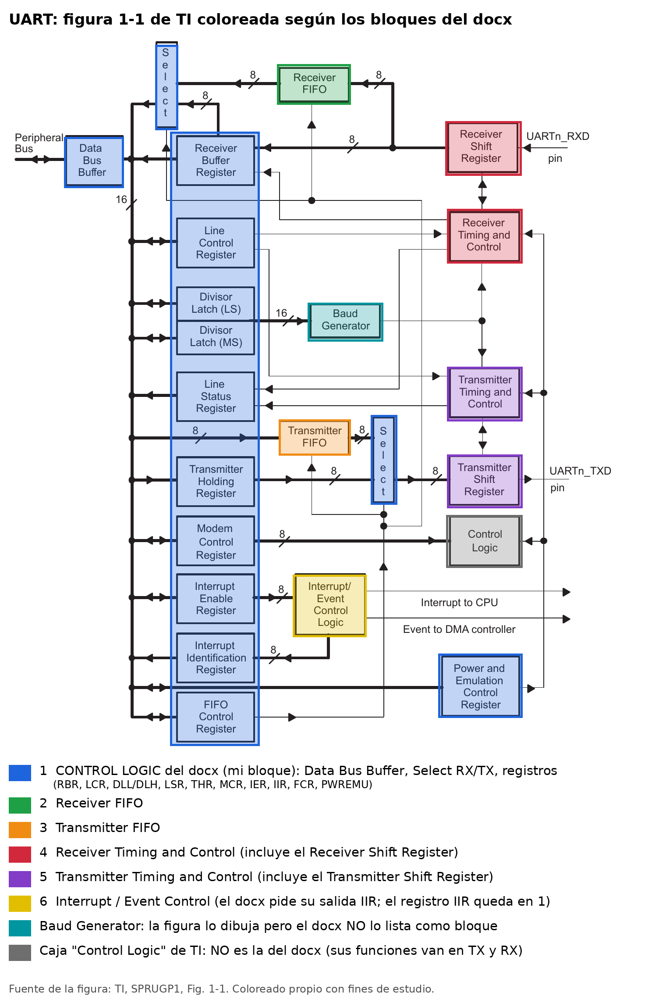

# UART – (Cuarta Actividad: Formal Verification)

## 1. Tarea a realizar
 
Se nos pide crear el **módulo UART**, dividido en estos bloques:
 
1. Buffer (Data Bus Buffer)
2. Register File
3. Divisor latch – Baud generator
4. Receiver / Transmitter FIFO
5. Receiver timing and control
6. Transmitter timing and control
7. **Control Logic** ← *el bloque que me tocó*
8. Interrupt / Event control

El tema del reto es **verificación formal**: escribir el RTL del bloque y verificarlo con
propiedades SVA (`assume` en entradas, `assert` en salidas/estados) usando **SymbiYosys**.

---

## 2. ¿Qué es un UART?
 
**UART** = *Universal Asynchronous Receiver/Transmitter*. Es un periférico que:
 
- convierte **paralelo → serial** los datos que envía la CPU (transmisión), y
- convierte **serial → paralelo** los datos que llegan por el cable (recepción).
Es **asíncrono**: no comparte reloj con el otro dispositivo. Ambos acuerdan una velocidad
(baudios) y cada carácter viaja dentro de una trama:
 
```
línea en reposo = 1
  ┌─────┬──────────────────┬─────────┬──────────┐
  │START│ 5–8 bits de dato │ PARIDAD │ 1–2 STOP │
  │ (0) │   (LSB primero)  │ (opc.)  │   (1)    │
  └─────┴──────────────────┴─────────┴──────────┘
```
 
Pines principales: `RXD` (entrada serial), `TXD` (salida serial) y, opcionalmente,
`RTS`(Request to Send) / `CTS`(Clear tu send) para control de flujo por hardware (*autoflow*).
 
La CPU lo controla **leyendo y escribiendo registros** a través de un bus de periférico.
 
---

## 3. Diagrama de conexión de los bloques

> El diagrama a continuación fue tomado de la guía de **Texas Instruments**.




---

### 3.1 Diferencias entre el diagrama de TI y el reparto del docx
 
| Tema | Figura 1-1 de TI | `UART_Signals.docx` |
|---|---|---|
| **Nombre "Control Logic"** | Es **una caja pequeña**: recibe la salida del MCR y se conecta con los bloques de timing y control y con el registro de energía/emulación. La guía no la describe en el texto. | Es **un bloque grande**: decodificación, registros, *Select* y *Data Bus Buffer*. **No es la misma caja**, solo comparte el nombre. |
| Registros (LCR, MCR, IER, FCR, DLL/DLH, etc.) | Cada uno es una caja suelta conectada al bus | Todos quedan **dentro** del Control Logic |
| Data Bus Buffer y los dos *Select* | Cajas sueltas | **Dentro** del bloque Control Logic |
| Funciones de la caja Control Logic de TI (loopback, autoflow con RTS/CTS) | Se ven conectadas al MCR y a los bloques de timing | En el docx están **repartidas** en el TX y el RX (señales `loop`, `afe`, `rts_n`, `cts_n`) |
| **Baud Generator** | Caja propia | **No aparece como bloque** en el docx: solo se menciona el `bclk_tick` y el `divisor` sale del bloque control logic. |
| Receiver FIFO y Transmitter FIFO | Cajas propias | Bloques propios (1 y 2) |
| Timing and Control + Shift Register | Cajas separadas | Cada timing and control **incluye** su registro de desplazamiento |
| Interrupt/Event Control + IIR | Caja de control + registro IIR | El bloque 6 genera el valor del IIR, y el Control Logic solo lo recibe y lo presenta en el bus |
| Eventos desde los bloques hacia Interrupt/Event Control | No se dibujan líneas | El docx sí define esas entradas (errores de línea, FIFO vacío, nivel de disparo…) |
 
> **Resumen:** el diagrama de arriba mantiene la estructura de TI, y el recuadro muestra qué parte
> del dibujo corresponde a **el** Control Logic según el UART_Signals.docx.
 
---


